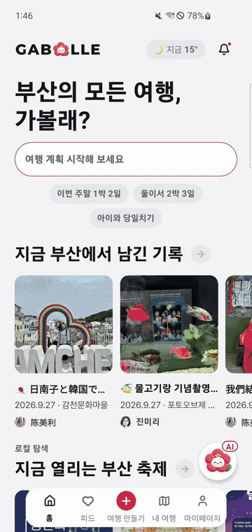

# 가볼래 (GABOLLE)

**외국인 여행객이 취향과 이동 조건에 맞춰 부산 여행 일정을 만드는 서비스입니다.** 날짜·예산·숙소·식단·보행 조건을 입력하면 코스를 고르고, 날짜별 일정과 이동 경로를 앱에서 확인할 수 있습니다.

| 항목 | 내용 |
| --- | --- |
| 기간·인원 | 2026.08 ~ 09 · SSAFY 15기 6인 팀 프로젝트 |
| 수상 | SSAFY 프로젝트 우수상 · 2026.09 |
| 제 담당 | 여행·일정 백엔드, PostgreSQL 저장·검증, 이벤트 수집 경로 수정 |
| 사용 기술 | Java 17, Spring Boot, Spring Data JPA, PostgreSQL, Flyway |

[앱 시연](#앱-시연) · [제가 맡은 일](#제가-맡은-일) · [문제 해결](#문제-해결) · [실행 방법](#실행-방법)

## 왜 만들었나요?

낯선 도시에서 여행 일정을 짤 때는 유명한 장소 목록만으로 부족합니다. 숙소에서 얼마나 걸리는지, 오래 걸어도 괜찮은지, 식사 제약에 맞는지도 함께 따져야 합니다. 가볼래는 여행자가 입력한 조건으로 장소를 고르고 일정을 만드는 과정을 돕기 위해 만들었습니다.

팀은 현지 장소 정보를 모으기 위해 설문을 진행했습니다. 장소 상세 화면에는 경사·계단 정보와 방문하기 좋은 시간 등을 표시하고, 확인되지 않은 정보는 미확인으로 남깁니다. 설문 원본과 집계 수치는 공개 저장소에 포함하지 않았습니다.

## 앱 시연

홈에서 여행 조건을 입력하고 지도에서 경로를 확인하는 36초 영상입니다. 팀의 앱 시연 원본에서 네 구간을 원래 속도로 이어 붙였습니다.

<p align="center">
  <a href="docs/demo/app-highlight.mp4"></a>
</p>

[시연 영상 보기 (MP4, 36초)](docs/demo/app-highlight.mp4)

| 홈 | 여행 조건 입력 | 일정 지도 |
| :---: | :---: | :---: |
|  |  |  |

사용자는 홈에서 장소와 축제를 살펴본 뒤 여행 날짜와 인원, 예산, 취향을 입력합니다. 코스를 선택하면 날짜별 일정과 지도에서 방문 순서를 확인합니다. 여행 중에 쓸 한국어 문장과 현장 도구도 앱에 마련했습니다.

## 제가 맡은 일

저는 앱의 여행 생성·일정 수정 요청을 받는 API와 저장 로직을 맡았습니다. 같은 생성 요청이 다시 들어왔을 때 여행이 늘어나지 않도록 고쳤고, 동행자의 일정 수정이 서로 덮어쓰지 않게 처리했습니다. 사용자 행동 이벤트가 메모리에만 남던 경로도 PostgreSQL 저장소로 연결했습니다.

화면, 추천 알고리즘, 개인화 실험, 배포는 팀원들이 나누어 개발했습니다. AI 도우미 서버 기능에도 참여했지만 해당 코드는 팀의 `back/dev` 브랜치에 있어, 이 공개본의 주요 구현 설명에서는 제외했습니다.

| 팀원 | 주 담당 |
| --- | --- |
| 박재현 | Spring 서버와 공통 API |
| 진미리 | 여행 화면과 사용자 흐름 |
| 모진성 | 여행·일정 서버 기능, PostgreSQL 저장과 검증 |
| 장효준 | 장소 제약 판정과 추천 로직 |
| 고지혁 | 개인화 실험, 모델·배치 작업 환경 |
| 이예승 | 인프라, 배포, QA |

## 문제 해결

### 같은 요청으로 여행이 두 번 만들어지는 문제

휴대폰이 서버 응답을 받지 못하면 사용자가 여행 만들기를 다시 누를 수 있습니다. 처음에는 요청 키가 있는지 조회한 뒤 여행을 저장했습니다. 두 요청이 동시에 들어오면 둘 다 키가 없다고 판단할 수 있었습니다.

저장 순서를 바꿔 **DB에서 요청 키를 먼저 확보한 요청만 여행을 만들도록** 했습니다. 같은 사용자와 같은 `Idempotency-Key`를 한 번만 저장하게 하고, 이미 사용한 키면 요청 내용도 비교합니다. 내용이 같으면 기존 여행과 HTTP 200을 반환하고, 다르면 409로 거절합니다. 새 여행은 201로 응답합니다. 같은 요청을 반복해도 결과가 늘어나지 않게 하는 처리입니다.

[여행 생성 서비스](backend/src/main/java/com/gabolle/backend/trip/application/TripCreationService.java) · [DB 저장 코드](backend/src/main/java/com/gabolle/backend/trip/infra/JpaTripRepository.java) · [동시 요청 테스트](backend/src/test/java/com/gabolle/backend/trip/TripCreationTest.java) · [PostgreSQL 통합 테스트](backend/src/test/java/com/gabolle/backend/trip/TripPersistenceIntegrationTest.java)

8개 동시 요청 테스트는 메모리 저장소를 사용합니다. 실제 PostgreSQL에서는 같은 키의 재요청과 DB 제약을 별도 통합 테스트로 확인했습니다.

### 동행자의 일정 수정이 서로 덮어쓰는 문제

두 사람이 같은 일정의 5번 버전을 보고 수정하면, 나중에 저장한 내용이 앞사람의 변경을 지울 수 있습니다. 저장 직전에 최신 버전을 읽어도 읽기와 쓰기 사이에 다른 요청이 들어올 수 있었습니다.

수정 요청에 사용자가 읽은 버전을 함께 받았습니다. DB에서는 같은 버전을 중복 저장하지 못하게 하고, 최신 버전도 사용자가 읽은 값과 일치할 때만 바꿉니다. 먼저 저장한 요청만 성공하며, 충돌한 요청에는 409를 반환해 사용자가 최신 일정을 다시 확인하도록 했습니다.

8개 동시 수정 테스트에서는 1개가 성공하고 7개가 거절되며, 이 테스트도 메모리 저장소를 사용합니다. PostgreSQL 통합 테스트에서는 중복 버전 저장과 최신 버전 갱신 충돌, 실패한 수정의 롤백을 확인했습니다.

[일정 저장 코드](backend/src/main/java/com/gabolle/backend/itinerary/infra/JpaItineraryRepository.java) · [동시 수정 테스트](backend/src/test/java/com/gabolle/backend/itinerary/ItineraryVersionConflictTest.java) · [PostgreSQL 통합 테스트](backend/src/test/java/com/gabolle/backend/itinerary/ItineraryPersistenceIntegrationTest.java)

### 메모리 테스트는 통과했지만 실제 DB에서는 실패했던 처리

일정 버전 충돌을 처리할 때 처음에는 `SAVEPOINT`로 여러 DB 작업 중 일부만 되돌릴 지점을 두려 했습니다. 메모리 저장소에서는 드러나지 않던 문제가 PostgreSQL 통합 테스트에서 나타났습니다. 당시 Spring 설정이 이 방식의 중첩 트랜잭션을 지원하지 않아 예외가 났습니다.

중복이면 예외를 낸 뒤 복구하는 대신 `INSERT ... ON CONFLICT DO NOTHING`으로 저장을 건너뛰도록 바꿨습니다. 저장한 행이 0개면 충돌로 판단합니다. 최신 버전 갱신에도 조건부 `UPDATE`를 사용해, 트랜잭션을 복구하는 별도 절차 없이 충돌을 처리했습니다.

### 성공 응답 뒤에도 이벤트 기록이 사라지는 문제

사용자 행동 이벤트 API가 DB 대신 메모리 저장소를 호출하고 있어 서버를 다시 시작하면 기록이 사라졌습니다. 저장소 구현을 추적해 이벤트를 외부로 보내기 전에 DB에 먼저 남기는 Outbox 테이블로 연결했습니다. 제가 수정한 범위는 이벤트 수집·저장 경로이며, Outbox 전체 설계는 팀 작업입니다.

공개본의 발행자는 `NoOpEventPublisher`입니다. 이벤트 저장까지 포함하고, Kafka로 전달하는 기능은 포함하지 않습니다. [이벤트 수집 서비스](backend/src/main/java/com/gabolle/backend/event/application/EventIngestService.java) · [Outbox 저장 서비스](backend/src/main/java/com/gabolle/backend/event/application/OutboxService.java)

## 서비스 구성


앱은 Expo·React Native로 만들었고, Spring Boot 서버가 API와 데이터 저장을 담당합니다. 장소 데이터 가공은 Node.js·Python 작업으로 나눴습니다. 일반 저장은 JPA를 사용하되 중복 요청과 일정 충돌은 PostgreSQL의 고유 제약과 SQL로 처리했습니다. DB 구조 변경은 Flyway SQL 파일로 관리했습니다.

| 위치 | 내용 |
| --- | --- |
| `frontend/` | 앱·웹 화면, TypeScript, Expo Router |
| `backend/` | API, Spring Security 인증, JPA 저장, Flyway 변경 이력 |
| `bigData/` | 장소·교통·지형 데이터 수집과 가공 |
| `infra/personalization/` | 개인화 실험 환경 |

개인화 실험 결과와 데이터 가공 결과를 온라인 추천에 자동 연결하는 경로는 공개본에서 검증하지 않았습니다. 추천 성능이나 실제 서비스 이용 성과를 수치로 제시할 단계는 아닙니다.

### 여행 생성 요청이 처리되는 순서

<a href="docs/architecture/trip-create.html"></a>

여행 생성과 추천 일정 계산은 별도 API입니다. [다이어그램 HTML](docs/architecture/trip-create.html) · [DB 운영 기준](docs/DB-STANDARD.md)

## 협업과 회고

Jira 업무를 Epic·Story·Task로 나누고 브랜치와 커밋에 티켓 키를 넣었습니다. 파트별 개발 브랜치를 거쳐 병합했고, 규칙은 [CONTRIBUTING.md](CONTRIBUTING.md)에 남겼습니다.

이번 프로젝트에서는 메모리 테스트가 통과해도 DB 저장이 안전하다고 판단할 수 없다는 것을 배웠습니다. PostgreSQL 통합 테스트에서 저장 제약과 트랜잭션 오류를 발견한 뒤, 동시 요청 로직과 실제 DB 동작을 나눠 확인했습니다. 다음에는 실제 DB를 사용하는 동시 요청 검증과 이벤트 발행 경로를 더 보강하려고 합니다.

## 실행 방법

프런트엔드는 Node.js 20 이상이 필요합니다.

```bash
cd frontend
cp .env.example .env
npm install
npm run web
```

백엔드는 Java 17과 Docker가 필요합니다. `.env`의 비밀번호와 비밀키를 설정한 뒤 실행합니다.

```bash
cd backend
cp .env.example .env
docker compose up --build -d
```

[백엔드 실행 안내](backend/README.md) · [프런트엔드 안내](frontend/README.md) · [팀 기획·설계 문서 6종](docs/gabolle/README.md) · [라이선스](LICENSE)
