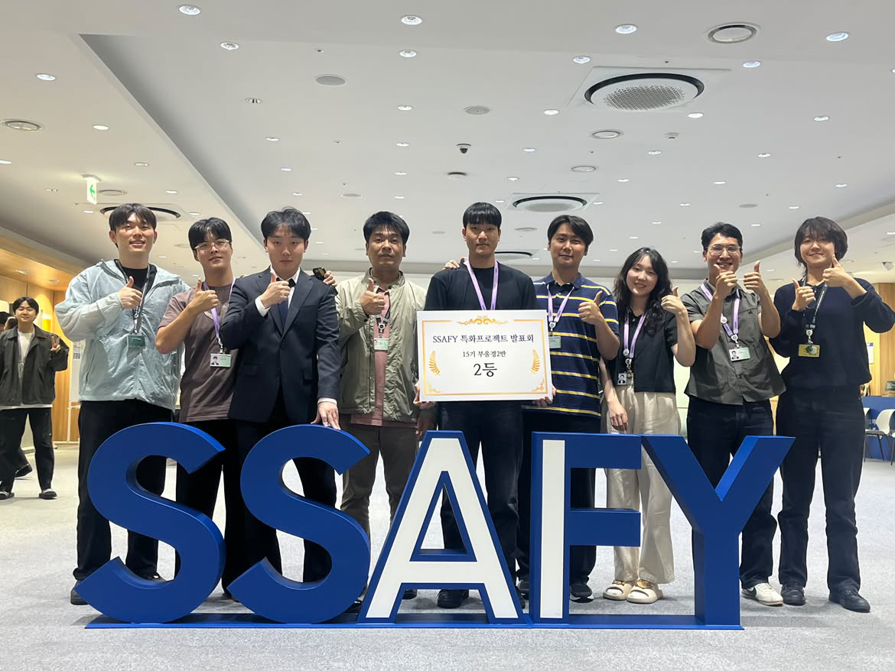
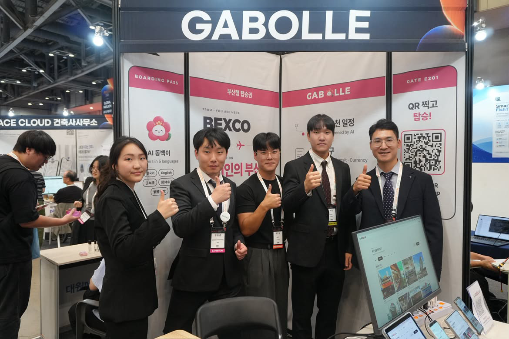

# 가볼래 (GABOLLE)

**외국인 여행객이 취향과 이동 조건에 맞춰 부산 여행 일정을 만드는 서비스입니다.** 날짜·예산·숙소·식단·보행 조건을 입력하면 코스를 고르고, 날짜별 일정과 이동 경로를 앱에서 확인할 수 있습니다.

| 항목 | 내용 |
| --- | --- |
| 기간·인원 | 2026.08 ~ 09 · SSAFY 15기 6인 팀 프로젝트, 이후 앱 업데이트 진행 중 |
| 수상 | SSAFY 특화프로젝트 우수상 (15기 부울경 2반 2등) · 2026.09 |
| 전시 | FLY ASIA 2026 부스 전시 · 2026.10 · 부산 BEXCO |
| 맡은 역할 | 여행·일정 백엔드 API, PostgreSQL 저장과 검증, 이벤트 저장 경로 수정 |
| 사용 기술 | Java 17, Spring Boot, Spring Data JPA, PostgreSQL, Flyway |

[앱 시연](#앱-시연) · [맡은 역할](#맡은-역할) · [해결한 문제](#해결한-문제) · [트러블슈팅](#트러블슈팅) · [수상과 전시](#수상과-전시) · [실행 방법](#실행-방법)

## 프로젝트 소개

낯선 도시에서 여행 일정을 짤 때는 유명한 장소 목록만으로 부족합니다. 숙소에서 얼마나 걸리는지, 오래 걸어도 괜찮은지, 식사 제약에 맞는지도 함께 따져야 합니다. 가볼래는 여행자가 입력한 조건으로 장소를 고르고 일정을 만드는 과정을 돕기 위해 만들었습니다.

팀은 현지 장소 정보를 모으기 위해 설문을 진행했습니다. 장소 상세 화면에는 경사·계단 정보와 방문하기 좋은 시간 등을 표시하고, 확인되지 않은 정보는 미확인으로 남깁니다. 설문 원본과 집계 수치는 공개 저장소에 포함하지 않았습니다.

## 앱 시연

홈에서 여행 조건을 입력하고 지도에서 경로를 확인하는 36초 영상입니다. 팀의 앱 시연 원본에서 네 구간을 원래 속도로 이어 붙였습니다.

<p align="center">
  <a href="docs/demo/app-highlight.mp4"></a>
</p>

[시연 영상 보기 (MP4, 36초)](docs/demo/app-highlight.mp4)

| 홈 | 여행 조건 입력 | 일정 지도 |
| :---: | :---: | :---: |
|  |  |  |

사용자는 홈에서 장소와 축제를 살펴본 뒤 여행 날짜와 인원, 예산, 취향을 입력합니다. 코스를 선택하면 날짜별 일정과 지도에서 방문 순서를 확인합니다. 여행 중에 쓸 한국어 문장과 현장 도구도 앱에 마련했습니다.

## 맡은 역할

여행 생성과 일정 수정 요청을 받는 API, 그리고 이 데이터를 PostgreSQL에 저장하는 로직을 맡았습니다. 앱의 AI 챗봇 동백이의 서버도 처음 설계해 만들었습니다([AI 챗봇 동백이](#ai-챗봇-동백이)).

화면, 추천 알고리즘, 개인화 실험, 배포는 팀원들이 나누어 개발했습니다.

| 팀원 | 주 담당 |
| --- | --- |
| 박재현 | Spring 서버와 공통 API |
| 진미리 | 여행 화면과 사용자 흐름 |
| 모진성 | 여행·일정 서버 기능, PostgreSQL 저장과 검증, AI 챗봇 서버 |
| 장효준 | 장소 제약 판정과 추천 로직 |
| 고지혁 | 개인화 실험, 모델·배치 작업 환경 |
| 이예승 | 인프라, 배포, QA |

## AI 챗봇 동백이

앱 오른쪽 아래의 동백이에게 자연어로 물으면, 서버가 질문을 세 가지 답 중 하나로 바꿔 돌려줍니다. 알맞은 앱 화면으로 보내는 안내(`navigate`), 여행지에서 바로 쓸 한국어 문장(`phrase`), 서비스 사용법 도움말(`help`)입니다. 저는 이 챗봇의 서버 API를 처음 설계하고 만들었습니다(2026.09.10 ~ 09.21). 대화 화면은 팀원들이 만들었고, 이후 운영 중에 생긴 호출 한도 문제 등은 팀원이 이어받아 고쳤습니다.

**만든 방식**

- 요청은 `POST /api/v1/assistant/messages` 하나로 받습니다. 모델에게 자유로운 문장 대신 정해진 JSON 형식으로만 답하게 하고(구조화 출력), 서버가 그 값을 검증한 뒤 앱에 내려줍니다.
- 모델 호출은 `AssistantVendorPort` 인터페이스 뒤에 두었습니다. 처음에는 Claude Haiku 4.5로 만들었는데, 무료로 쓸 수 있는 Google Gemini로 바꿀 때 어댑터 클래스 하나만 갈아 끼웠고 서비스와 컨트롤러는 그대로였습니다.
- 대화 내용은 서버에 저장하지 않습니다. 앱이 최근 대화 몇 턴을 함께 보내면 이어지는 대화로 모델에 넘깁니다.
- 답변 언어는 앱이 보내는 `Accept-Language` 헤더로 맞춥니다. 앱이 지원하는 한국어, 영어, 일본어, 중국어(간체·번체)에 맞춰 서버의 언어 처리도 넓혔습니다.
- 사용자마다 1분에 10번까지 물을 수 있고, 넘으면 429를 돌려줍니다.
- 사용자가 동의하고 일정을 골랐을 때만 그날 일정(장소, 시각, 도보 거리)을 읽어 답에 씁니다. 알레르기 같은 건강 정보는 모델에 보내지 않습니다. 동의가 없으면 403, 내 일정이 아니면 404입니다.
- 버스 실시간 도착 정보(공공데이터포털 TAGO)와 환율(한국수출입은행) API도 서버에 연동했습니다. 챗봇은 이 정보를 직접 말하지 않고 해당 화면으로 안내합니다.

**사용 기술** Java 17, Spring Boot, Google Gemini API(구조화 출력), Claude API(첫 버전), JUnit, Docker Compose(로그인부터 챗봇 호출까지 로컬에서 확인), GitLab CI

챗봇이 서울에 있는 가게를 추천하던 할루시네이션을 막은 과정은 [트러블슈팅 5](#5-ai-챗봇이-부산이-아닌-서울에-있는-가게를-추천하던-문제)에 정리했습니다. 챗봇 서버 코드는 팀 GitLab 저장소의 `back/dev` 브랜치에 있어 이 공개 저장소에는 포함되어 있지 않습니다.

## 해결한 문제

| 문제 | 해결 | 결과 |
| --- | --- | --- |
| 응답을 못 받은 사용자가 다시 누르면 여행이 두 번 생성됨 | 요청 키(`Idempotency-Key`)를 DB에 먼저 저장한 요청만 여행 생성 | 같은 키 요청 8개를 동시에 보내도 여행 1개 |
| 동행자 두 명이 동시에 고치면 앞사람의 변경이 지워짐 | 사용자가 읽은 버전과 DB 버전이 같을 때만 수정, 다르면 409 | 동시 수정 8개 중 1개만 성공, 7개 거절 |
| 메모리 테스트는 통과했지만 실제 PostgreSQL에서 충돌 처리가 실패함 | 예외 복구 대신 `ON CONFLICT DO NOTHING`과 조건부 `UPDATE`로 판단 | PostgreSQL 통합 테스트로 확인 |
| 성공 응답 뒤에도 서버를 재시작하면 이벤트 기록이 사라짐 | 메모리 저장소로 가던 경로를 PostgreSQL Outbox 테이블로 연결 | 재시작해도 이벤트가 DB에 남음 |
| AI 챗봇이 부산 여행 앱에서 서울에 있는 가게를 추천함(모델이 학습한 지식으로 답함) | 답장은 서버가 조립하고, 챗봇은 화면 안내·여행 문장·도움말 세 가지로만 답하게 좁힘 | 장소 추천을 물어도 이름을 지어내지 않고 여행 만들기 화면으로 안내 |

자세한 과정은 아래 [트러블슈팅](#트러블슈팅)에 정리했습니다.

## 트러블슈팅

### 1. 같은 요청이 동시에 오면 여행이 중복 생성되던 문제

**문제** 휴대폰이 서버 응답을 받지 못하면 사용자는 여행 만들기를 다시 누를 수 있습니다. 같은 요청이 두 번 오면 여행이 두 개 생길 수 있었습니다.

**원인** 처음에는 요청 키가 있는지 조회한 뒤 여행을 저장했습니다. 두 요청이 동시에 들어오면 둘 다 "키가 없다"고 판단해 각자 여행을 만들 수 있었습니다. 조회와 저장 사이의 짧은 틈이 문제였습니다.

**해결** 저장 순서를 바꿔 **DB에서 요청 키를 먼저 확보한 요청만 여행을 만들도록** 했습니다. 같은 사용자와 같은 `Idempotency-Key`는 한 번만 저장되고, 이미 쓴 키면 요청 내용을 비교합니다. 내용이 같으면 기존 여행과 HTTP 200을, 다르면 409를 돌려줍니다. 새 여행은 201로 응답합니다.

<a href="docs/architecture/trip-create.html"></a>

<sub>여행 생성 요청이 처리되는 순서입니다. 여행 생성과 추천 일정 계산은 별도 API입니다.</sub>

**결과** 같은 키로 8개 요청을 동시에 보내도 여행은 1개만 생기고, 나머지 7개는 같은 여행을 돌려받습니다. 프로젝트 때는 이 동시 요청 테스트를 메모리 저장소로 돌렸고, 프로젝트 후 실제 PostgreSQL 통합 테스트로도 확인했습니다.

[여행 생성 서비스](backend/src/main/java/com/gabolle/backend/trip/application/TripCreationService.java) · [DB 저장 코드](backend/src/main/java/com/gabolle/backend/trip/infra/JpaTripRepository.java) · [동시 요청 테스트](backend/src/test/java/com/gabolle/backend/trip/TripCreationTest.java) · [PostgreSQL 통합 테스트](backend/src/test/java/com/gabolle/backend/trip/TripPersistenceIntegrationTest.java) · [다이어그램 HTML](docs/architecture/trip-create.html) · [DB 운영 기준](docs/DB-STANDARD.md)

### 2. 동행자 두 명이 동시에 고치면 앞사람의 변경이 지워지던 문제

**문제** 두 사람이 같은 일정의 5번 버전을 보고 수정하면, 나중에 저장한 내용이 앞사람의 변경을 지울 수 있었습니다.

**원인** 저장 직전에 최신 버전을 다시 읽어도, 읽기와 쓰기 사이에 다른 요청이 끼어들 수 있었습니다.

**해결** 수정 요청에 사용자가 읽은 버전을 함께 받았습니다. DB에서는 같은 버전을 중복 저장하지 못하게 하고, 최신 버전도 사용자가 읽은 값과 일치할 때만 바꿉니다. 먼저 저장한 요청만 성공하고, 충돌한 요청에는 409를 돌려줘 사용자가 최신 일정을 다시 확인하게 했습니다.

**결과** 8개 동시 수정 테스트에서 1개만 성공하고 7개는 거절됩니다. 프로젝트 때는 이 테스트를 메모리 저장소로 돌렸고, 프로젝트 후 실제 PostgreSQL에서도 같은 결과를 확인했습니다. PostgreSQL 통합 테스트에서는 중복 버전 저장과 최신 버전 갱신 충돌, 실패한 수정의 롤백도 확인합니다.

[일정 저장 코드](backend/src/main/java/com/gabolle/backend/itinerary/infra/JpaItineraryRepository.java) · [동시 수정 테스트](backend/src/test/java/com/gabolle/backend/itinerary/ItineraryVersionConflictTest.java) · [PostgreSQL 통합 테스트](backend/src/test/java/com/gabolle/backend/itinerary/ItineraryPersistenceIntegrationTest.java)

### 3. 메모리 테스트는 통과했지만 실제 PostgreSQL에서는 실패하던 충돌 처리

**문제** 일정 버전 충돌을 처리할 때 처음에는 `SAVEPOINT`로 여러 DB 작업 중 일부만 되돌릴 지점을 두려 했습니다. 메모리 저장소 테스트는 통과했지만 PostgreSQL 통합 테스트에서 실패했습니다.

**원인** 당시 Spring 설정이 이 방식의 중첩 트랜잭션을 지원하지 않아 예외가 났습니다.

**해결** 중복이면 예외를 낸 뒤 복구하는 대신 `INSERT ... ON CONFLICT DO NOTHING`으로 저장을 건너뛰고, 저장한 행이 0개면 충돌로 판단하게 바꿨습니다. 최신 버전 갱신에도 조건부 `UPDATE`를 써서, 트랜잭션을 복구하는 별도 절차 없이 충돌을 처리했습니다.

**결과** 바꾼 방식으로 PostgreSQL 통합 테스트에서 중복 버전 저장과 최신 버전 갱신 충돌을 확인했습니다.

### 4. 성공 응답을 받았는데 이벤트 기록이 사라지던 문제

**문제** 사용자 행동 이벤트 API는 저장에 성공했다고 응답했지만, 서버를 다시 시작하면 기록이 사라졌습니다.

**원인** 저장소 구현을 따라가 보니 이벤트 API가 DB가 아니라 메모리 저장소를 호출하고 있었습니다.

**해결** 이벤트를 외부로 보내기 전에 DB에 먼저 남기는 Outbox 테이블로 저장 경로를 연결했습니다. 제가 수정한 범위는 이벤트 수집·저장 경로이며, Outbox 전체 설계는 팀 작업입니다.

**남은 과제** 공개본의 발행자는 `NoOpEventPublisher`라서 이벤트 저장까지만 포함하고, Kafka로 전달하는 기능은 포함하지 않습니다.

[이벤트 수집 서비스](backend/src/main/java/com/gabolle/backend/event/application/EventIngestService.java) · [Outbox 저장 서비스](backend/src/main/java/com/gabolle/backend/event/application/OutboxService.java)

### 5. AI 챗봇이 부산이 아닌 서울에 있는 가게를 추천하던 문제

**문제** 첫 버전의 챗봇은 대화에서 여행 조건을 뽑아 일정 조건을 채우고, 사용자에게 보이는 답장은 모델이 자유롭게 썼습니다. 그러자 부산 여행 앱인데 **부산이 아닌 서울에 있는 가게를 추천**하는 답이 나왔습니다. 모델이 가볼래 데이터가 아니라 자기가 학습한 지식으로 답한 것입니다. 가볼래는 설문과 현지인 추천으로 모은 실제 부산 장소를 추천하는 서비스라, 이런 답은 서비스의 근거를 무너뜨립니다.

**원인** 모델이 쓴 문장이 그대로 사용자에게 나가는 구조라, 모델이 아는 가게라면 부산 밖이든 가볼래 데이터 밖이든 그대로 답에 실렸습니다. 프롬프트에 "장소 이름을 지어내지 말라"고 적어도, 지어낸 답이 나갈 통로는 남아 있었습니다.

**해결** 프롬프트에만 기대지 않고, 지어낸 내용이 나갈 길을 구조로 막았습니다.

1. **답장은 서버가 조립했습니다.** 모델은 지역, 인원, 음식 취향 같은 값만 채우고, 사용자에게 보이는 요약(예: "지역: 해운대, 광안리", "인원: 2명")은 서버 코드가 그 값만으로 만들게 했습니다. 이 조립 코드는 모델 없이 단위 테스트로 확인했습니다.
2. **챗봇의 역할을 안내로 좁혔습니다.** 이어서 일정을 대신 짜는 기능 자체를 빼고, 은행 앱 챗봇처럼 화면 안내·여행 문장·도움말 세 가지로만 답하게 했습니다. 장소 추천은 실제 데이터로 추천하는 여행 만들기 화면이 맡고, 화면 안내는 서버의 허용 목록에 있는 화면(여행 만들기, 내 여행, 번역, 버스 도착, 환율)으로만 보냅니다.
3. **매번 바뀌는 숫자는 말하지 않게 했습니다.** 버스 도착 시간이나 환율을 물으면 숫자를 직접 답하지 않고, 실제 API 값을 보여 주는 화면으로 안내합니다.
4. **근거가 있을 때만 예외를 두었습니다.** 사용자가 동의하고 일정을 골랐을 때만 그 일정 데이터를 근거로 조언합니다. 여행이나 앱과 관계없는 질문(시사, 코딩 등)은 범위를 알리고 거절합니다.

**결과** Docker와 PostgreSQL로 띄운 서버에서 실제 Gemini를 호출해 확인했습니다. 구체적인 장소 추천을 요청해도 이름을 지어내지 않고 여행 만들기 화면으로 안내했고, 환율을 물으면 숫자 대신 환율 화면으로 안내했으며, 범위 밖 질문은 거절했습니다.

**함께 고친 문제**

- **구조화 출력에서 뒤쪽 값이 빠짐** Gemini에 응답 형식을 `Map.of()`로 넘기면 필드 순서가 보장되지 않아, 모델이 뒤쪽 필드(여행 일수, 인원)를 빠뜨리는 경우가 있었습니다. `propertyOrdering`으로 순서를 명시해 고쳤고, 버튼 문구가 비어 오면 화면별 기본 문구를 쓰게 했습니다.
- **챗봇의 이동 버튼이 앱에서 사라짐** 앱은 모르는 화면 주소의 버튼을 지우는데, 서버 목록을 손으로 베껴 검사하다 보니 챗봇 이동 버튼 세 개가 사라진 일이 있었습니다. 이후 서버의 허용 목록과 앱의 화면 목록을 원본 파일끼리 대조하는 CI 검사를 만들었습니다. 서버가 보낼 수 있는 주소를 앱이 모르면 검사가 실패합니다.

## 서비스 구성


앱은 Expo·React Native로 만들었고, Spring Boot 서버가 API와 데이터 저장을 담당합니다. 장소 데이터 가공은 Node.js·Python 작업으로 나눴습니다. 일반 저장은 JPA를 사용하되 중복 요청과 일정 충돌은 PostgreSQL의 고유 제약과 SQL로 처리했습니다. DB 구조 변경은 Flyway SQL 파일로 관리했습니다.

| 위치 | 내용 |
| --- | --- |
| `frontend/` | 앱·웹 화면, TypeScript, Expo Router |
| `backend/` | API, Spring Security 인증, JPA 저장, Flyway 변경 이력 |
| `bigData/` | 장소·교통·지형 데이터 수집과 가공 |
| `infra/personalization/` | 개인화 실험 환경 |

개인화 실험 결과와 데이터 가공 결과를 온라인 추천에 자동 연결하는 경로는 공개본에서 검증하지 않았습니다. 추천 성능이나 실제 서비스 이용 성과를 수치로 제시할 단계는 아닙니다.

## 수상과 전시

| SSAFY 특화프로젝트 발표회 우수상 | FLY ASIA 2026 전시 부스 |
| :---: | :---: |
|  |  |
| 15기 부울경 2반 2등 · 2026.09 | 부산 BEXCO · 2026.10.07 ~ 08 |

SSAFY 특화프로젝트 발표회에서 반 2등으로 우수상을 받았습니다. 프로젝트 기간이 끝난 뒤에도 팀은 앱 업데이트를 이어 가고 있고, 2026년 10월에는 부산 BEXCO에서 열린 스타트업 행사 FLY ASIA 2026에 부스를 열었습니다. 방문객은 부스의 QR 코드로 앱을 바로 열어 볼 수 있었습니다. 행사 전에는 시연 녹화에서 나온 앱 문제를 먼저 고쳐 전시에 대비했습니다.

## 협업과 회고

Jira 업무를 Epic·Story·Task로 나누고 브랜치와 커밋에 티켓 키를 넣었습니다. 파트별 개발 브랜치를 거쳐 병합했고, 규칙은 [CONTRIBUTING.md](CONTRIBUTING.md)에 남겼습니다.

이번 프로젝트에서는 메모리 테스트가 통과해도 DB 저장이 안전하다고 판단할 수 없다는 것을 배웠습니다. PostgreSQL 통합 테스트에서 저장 제약과 트랜잭션 오류를 발견한 뒤, 동시 요청 로직과 실제 DB 동작을 나눠 확인했습니다. 프로젝트 후에는 실제 PostgreSQL에서 8개 동시 요청도 검증했습니다. 다음에는 이벤트 발행 경로를 더 보강하려고 합니다.

## 실행 방법

프런트엔드는 Node.js 20 이상이 필요합니다.

```bash
cd frontend
cp .env.example .env
npm install
npm run web
```

백엔드는 Java 17과 Docker가 필요합니다. `.env`의 비밀번호와 비밀키를 설정한 뒤 실행합니다.

```bash
cd backend
cp .env.example .env
docker compose up --build -d
```

[백엔드 실행 안내](backend/README.md) · [프런트엔드 안내](frontend/README.md) · [팀 기획·설계 문서 6종](docs/gabolle/README.md) · [라이선스](LICENSE)
